# Glass Dock

A floating, translucent dock for GNOME Shell 50 and 51, inspired by the macOS dock.

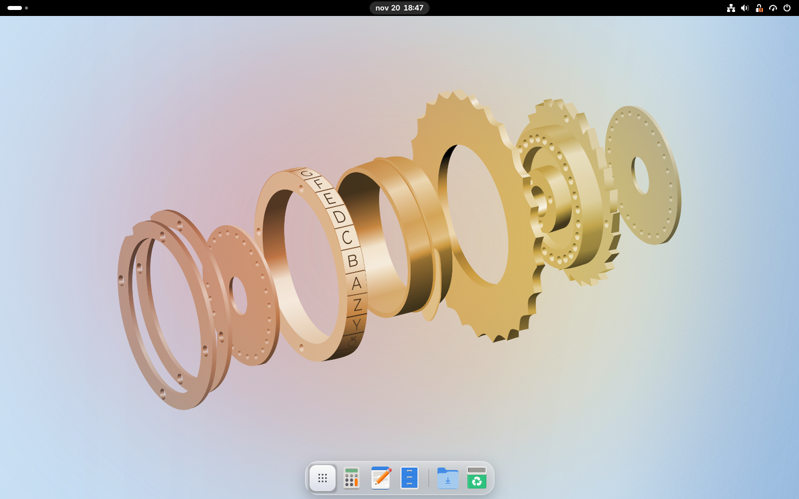

> **Note:** this extension was developed with the help of an AI coding
> assistant. Every source file carries a notice saying so, as the GNOME
> extensions team asks. It is published on GitHub; it is not on
> extensions.gnome.org.

## Features

- **Glass look.** Blurred, translucent background with a light edge and a soft
  shadow. Follows the system light/dark style.
- **Badges and progress** from apps (unread counts, downloads, updates).
- **Hover popup.** Rest the pointer on an app for live window previews and,
  for music and video players, a mini player with volume on scroll.
- **Folder stacks.** Any folder next to Downloads, with its newest file on the
  icon.
- **A dock on every monitor**, each with its own windows, and an option to
  show only the current workspace.
- **Liquid glass (experimental).** Lens-like edges, a light rim and a
  highlight that follows the pointer.
- **Ten styles.** Keep the glass and change how the dock behaves: a floating
  dock with zoom, full-width bars with plates, lines or pills, a glass shelf,
  neon and more. See [Styles](#styles).
- **Magnification.** Icons grow in a smooth wave under the pointer, with the
  app name above the icon.
- **One dot per window**, up to four. The focused app's dots stand out.
- **Clicks that handle several windows:**
  - A closed app opens, and its icon bounces until it starts.
  - An app in the background comes to the front with **all** its windows; the
    most recently used one gets focus.
  - A focused app with one window minimizes (or nothing; configurable).
  - A focused app with several windows shows **window previews** (live
    thumbnails; click to focus, × to close) or **App Exposé** (the screen dims
    and the app's windows spread out in a grid). Cycling through windows and
    minimizing all are also available.
  - Middle click or Ctrl+click opens a new window. Scrolling cycles windows.
- **Right-click menu.** GNOME's own app menu, plus *Show All Windows* (App
  Exposé).
- **Drag and drop.** Reorder icons, pin apps by dragging them from the app
  grid, and unpin by dragging them off the dock.
- **Minimize to the icon.** Windows shrink into their dock icon.
- **Auto-hide.** Never (the dock reserves screen space), always (push the
  screen edge to reveal it) or intellihide (hides when the focused window
  overlaps it). The dock hides in fullscreen.
- **Right section.** Recently used apps, a **Downloads stack** (fan or grid)
  and the **Trash** (empty/full, open, empty).
- **Recognizes stubborn apps.** Windows GNOME cannot match to their launcher
  (e.g. the Spotify snap) still show up on the right icon.
- **Fits the screen.** Icons shrink automatically when there are too many
  apps.
- **Position and monitor.** Bottom, left or right, on any monitor.
- **Languages:** English, Brazilian Portuguese, Spanish.

| Window previews | App Exposé |
|---|---|
| 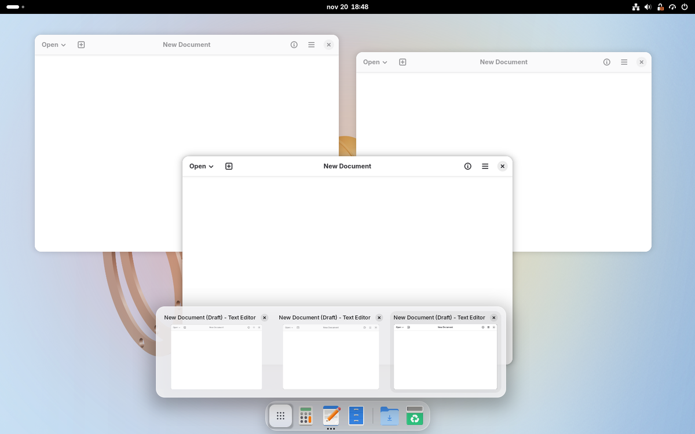 | 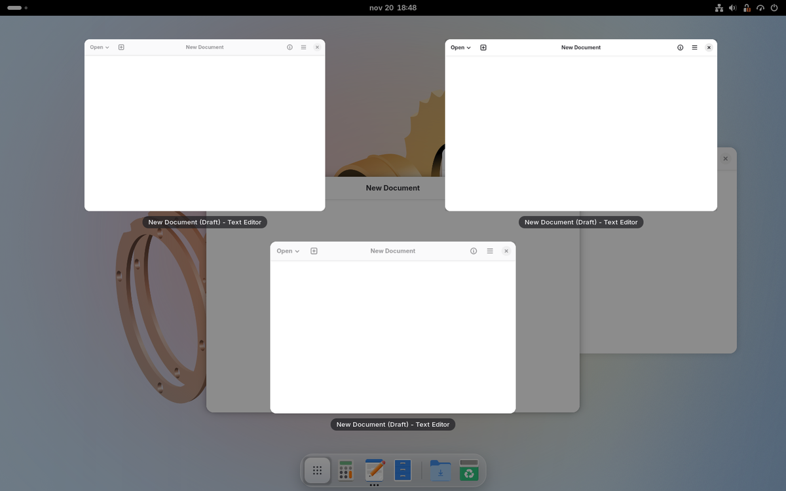 |

| Downloads as a fan | Downloads as a grid | Dark style, magnified |
|---|---|---|
| 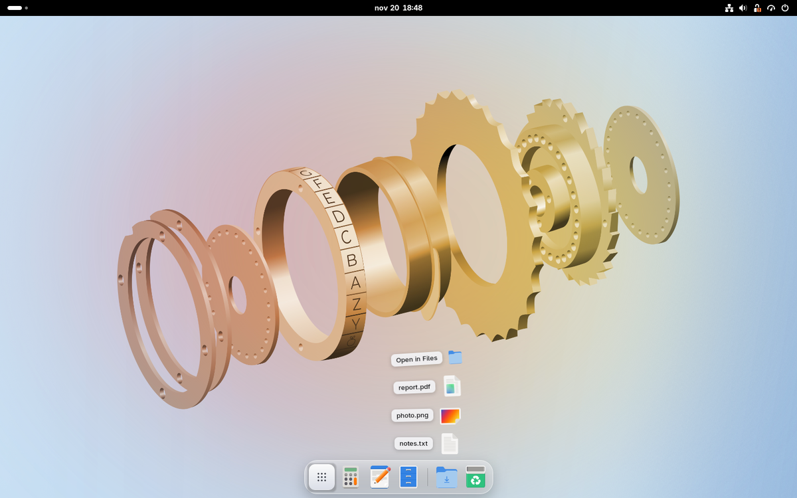 | 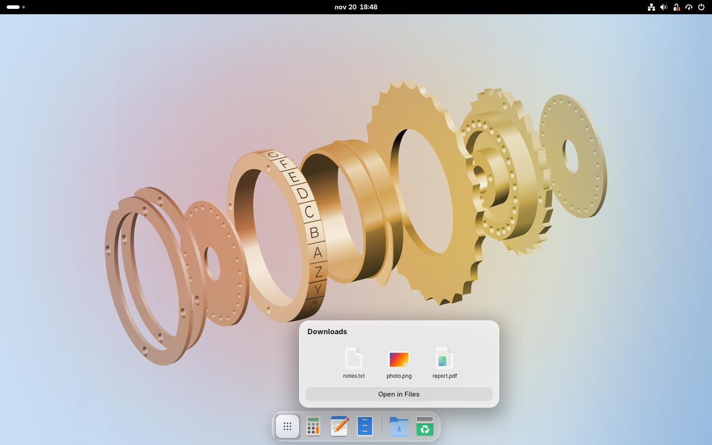 | 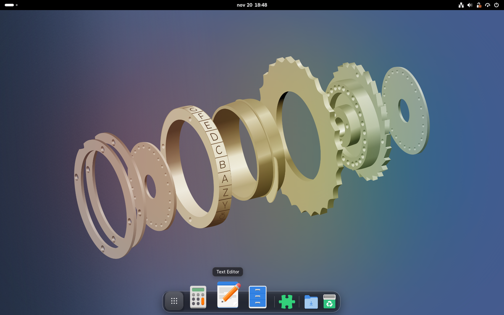 |

## Styles

Pick one in *Appearance → Style*. Every style keeps the glass look; what
changes is the shape of the dock, how open apps are marked, the Apps button
and the hover and click effects. Picking a style also applies its recommended
icon size and zoom, which you can change afterwards. Accent-colored details
follow the accent color chosen in GNOME Settings.

| Style | Inspired by | What it does |
|---|---|---|
| **Glass** (default) | macOS | Floating dock with zoom and one dot per window. |
| **Strip** | Windows XP | Full-width bar, labeled Apps button, open apps on raised plates; the focused one looks pressed. |
| **Orb** | Windows Vista | Full-width bar with a round Apps button rising above it; soft glow on hover. |
| **Glow** | Windows 7 | Larger icons; on hover, a glow in the icon's own color follows the pointer. |
| **Line** | Windows 10 | Flat full-width bar; a line under open apps spans the whole cell on the focused one. |
| **Center** | Windows 11 | Centered icons; a pill under open apps grows on the focused one; icons press in when clicked. |
| **Bevel** | Windows 95/98 | Raised buttons that sink when focused, with no fades. |
| **Shelf** | Mac OS X Leopard | Icons stand on a glass shelf in perspective, with reflections. |
| **Neon** | — | Glowing edge and an accent-colored halo that pulses on the focused app. |
| **Dash** | GNOME | No zoom, rounded highlight, Apps button at the end. |

Only the behavior is borrowed: no logos, artwork or other assets from those
systems are used.

| | |
|---|---|
| Strip 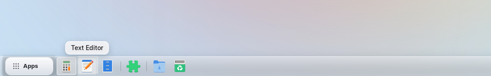 | Orb 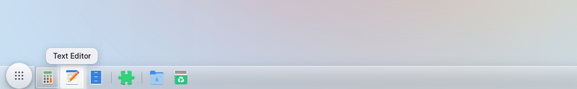 |
| Glow 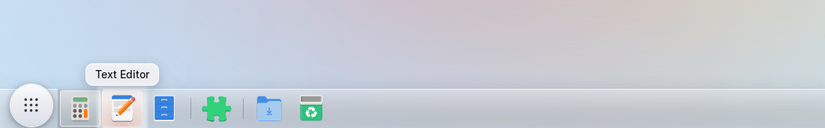 | Line 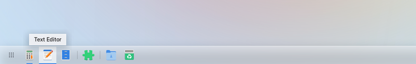 |
| Center 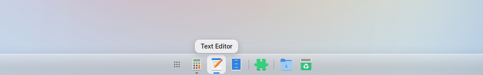 | Bevel 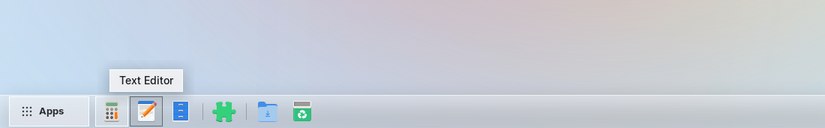 |
| Shelf 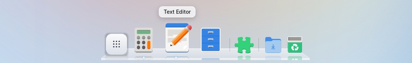 | Neon 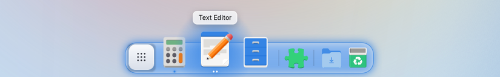 |
| Dash 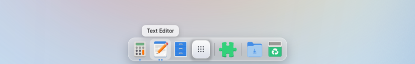 | Glass, dark 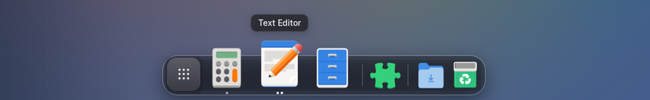 |

## Install

1. Download `glass-dock-vX.Y.Z.zip` from the
   [releases page](https://github.com/pdrmottadev/glass_dock/releases).
2. Install it:
   ```sh
   gnome-extensions install --force glass-dock-vX.Y.Z.zip
   ```
   Replace `X.Y.Z` with the version you downloaded.
3. Log out and back in (on Wayland GNOME Shell only loads new extensions at
   login), then:
   ```sh
   gnome-extensions enable glass-dock@pdrmottadev.github.io
   ```
4. Disable other docks (Dash to Dock, Ubuntu Dock, Dash to Panel) to avoid
   two docks on screen. Glass Dock shows a notification if one is enabled.

Settings: `gnome-extensions prefs glass-dock@pdrmottadev.github.io`, or the
Extensions app.

Requires **GNOME Shell 50 or 51**.

## Development

```sh
make install   # schema + translations, symlink into ~/.local/share/gnome-shell/extensions
make enable    # after logging out and back in
make lint      # ESLint (run `npm install` once)
make test      # end-to-end tests in an isolated headless GNOME Shell
make test-gnome50  # the same tests against GNOME Shell 50 in a Fedora 44 container (podman)
make release   # lint + test + zip in dist/
make pot       # refresh po/glass-dock.pot and merge the translations
```

### Tests

`tests/headless/run.sh` starts GNOME Shell in headless mode with its own
D-Bus bus, settings and extensions folder, so it never touches your session.
A test-only helper extension turns on *unsafe mode* there so the scenarios
can drive the shell through `org.gnome.Shell.Eval`. Scenarios cover
enable/disable cycles, launching, indicators, previews, App Exposé, drag and
drop, auto-hide, the Downloads stack, the Trash, fitting the screen, two
monitors and scale 2. `SCREENSHOTS=dir` also saves screenshots.

`tests/container/run-gnome50.sh` runs the same scenarios against GNOME
Shell 50 in a rootless podman container (Fedora 44, systemd as init so the
shell has a system bus and logind). The source tree is mounted read-only.

### Layout

| File | Role |
|---|---|
| `extension.js` | Entry point (enable/disable) |
| `src/dockManager.js` | Lifetime, rebuilds on settings/monitor changes, warns about other docks |
| `src/dock.js` | Actors, layout, magnification, tooltip, drag and drop, slide in/out, struts |
| `src/magnifier.js` | Magnification math (pure functions) |
| `src/styles.js` | Dock styles: shape, indicators, Apps button and effects |
| `src/launcherApi.js` | Badges and progress published by apps (LauncherEntry D-Bus API) |
| `src/hoverPopup.js` | Hover popup: live previews and the mini player |
| `src/mpris.js` | Media players on the session bus (MPRIS) |
| `src/liquidGlass.js` | Liquid glass shader over a clone of the windows behind the dock |
| `src/dockItem.js` | Dock items: base, app icon, Applications button, separator |
| `src/appsModel.js` | Pinned, running and recent apps |
| `src/autohide.js` | Auto-hide and intellihide |
| `src/overlay.js` | Shared modal layer (closes on Escape or outside click) |
| `src/windowPreviews.js` | Live window thumbnails and the previews popup |
| `src/expose.js` | App Exposé |
| `src/stacks.js` | Downloads stack |
| `src/trash.js` | Trash |
| `prefs.js` | Preferences (libadwaita) |

### Notes on GNOME Shell 50 and 51

- GNOME 51 renamed `St.ButtonMask.ONE`/`TWO` to `PRIMARY`/`MIDDLE` and warns on
  the old names; GNOME 50 only has the old ones, so the code picks whichever
  exists.
- Clutter 51 no longer emits `button-press-event` or `key-press-event`; use the
  generic `event` signal or gestures (`Clutter.ClickGesture`,
  `LongPressGesture`). `motion-event` and `scroll-event` still work.
- The Shell's drag and drop picks drop targets with `PickMode.ALL`, which
  includes non-reactive actors. That is why the dock's root actor is 1×1 px
  and the struts actor sits below the dock: a large invisible actor on top
  would swallow every drop.
- GNOME inhibits animations in remote sessions. The dock's own animations go
  through `Dock.ease()`, which passes `animationRequired` so they follow the
  user's `enable-animations` preference instead. Animations owned by GNOME,
  such as minimizing a window or opening its menus, stay off there.
- When activating a window outside an event (for example after an
  animation), pass the click's timestamp to `Main.activateWindow(w, time)`.
  With time 0 the window's user time is not updated and the most-recently-used
  order breaks.

## Known limitations

- `Shell.BlurEffect` has no rounded corners, so the blur is a rectangle set
  slightly inside the glass; the curved rim is translucent but not blurred.
  Liquid glass draws its own rounded mask and does not have this limit.
- Liquid glass shows the windows and the wallpaper behind the dock, not other
  parts of the Shell such as the top bar. It is not used with the Shelf style.
- Minimizing uses GNOME's scale animation toward the icon, not a genie effect.
- Files dragged from the Files app cannot be dropped on the dock's Trash:
  Wayland drag and drop from apps does not reach Shell chrome.
- Downloads thumbnails appear only once the system has generated them.

## Português (Brasil)

Dock flutuante e translúcido para o GNOME Shell 50 e 51, inspirado no Dock do
macOS. Tem vidro com desfoque, magnificação, um ponto por janela, prévias de
janelas e App Exposé quando o app tem várias janelas, ocultação automática,
pilha de Downloads e de qualquer pasta, Lixeira, badges e progresso dos apps,
prévias e mini player ao parar o ponteiro sobre um app, dock em todos os
monitores e vidro líquido experimental. Há dez estilos (Vidro,
Faixa, Orbe, Brilho, Linha, Central, Relevo, Prateleira, Neon e Dash) que
mantêm o vidro e mudam o formato, os indicadores e os efeitos. A interface está em inglês,
português e espanhol.

Para instalar, baixe o zip da página de releases e rode
`gnome-extensions install --force glass-dock-vX.Y.Z.zip`, trocando `X.Y.Z` pela
versão baixada. Depois saia da sessão,
entre de novo e rode `gnome-extensions enable glass-dock@pdrmottadev.github.io`.
Desative outros docks, como o Dash to Dock.

A extensão foi desenvolvida com ajuda de um assistente de IA, e cada arquivo
traz um aviso sobre isso.

## License

GPL-2.0-or-later. See [LICENSE](LICENSE).
